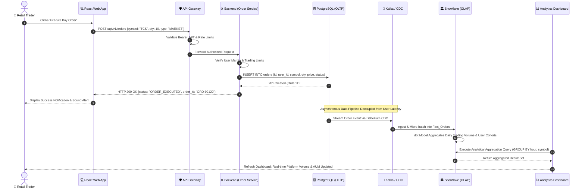

# End-to-End FinTech Data Flow Architecture

> **Task 4 Deliverable:** Architecture Documentation & Flow Diagrams  
> *Demonstrating the full lifecycle of data: User Action $\rightarrow$ Web App $\rightarrow$ Database $\rightarrow$ Data Pipeline $\rightarrow$ Analytics Dashboard*

---

## 1. High-Level System Flowchart

The diagram below details the 7-stage architectural data pipeline used by modern FinTech platforms (such as Bluestock):

```mermaid
flowchart TD
    %% Styling
    classDef client fill:#E0F2FE,stroke:#0284C7,stroke-width:2px,color:#0F172A;
    classDef gateway fill:#F1F5F9,stroke:#475569,stroke-width:2px,color:#0F172A;
    classDef backend fill:#FEF3C7,stroke:#D97706,stroke-width:2px,color:#0F172A;
    classDef oltp fill:#DCFCE7,stroke:#16A34A,stroke-width:2px,color:#0F172A;
    classDef pipeline fill:#F3E8FF,stroke:#9333EA,stroke-width:2px,color:#0F172A;
    classDef olap fill:#FCE7F3,stroke:#DB2777,stroke-width:2px,color:#0F172A;
    classDef bi fill:#CCFBF1,stroke:#0D9488,stroke-width:2px,color:#0F172A;

    subgraph Tier1["1. Client Tier (Frontend)"]
        User(["👤 User on Bluestock Web / App"]):::client
        UI["💻 React.js / Next.js Web App\n• User clicks 'Buy 10 TCS Shares'\n• Client validates input & formats payload"]:::client
    end

    subgraph Tier2["2. Edge & API Gateway"]
        Gateway["🛡️ API Gateway (Kong / NGINX / Cloudflare)\n• Rate Limiting & SSL Termination\n• JWT Token Authentication Check"]:::gateway
    end

    subgraph Tier3["3. Backend Microservices Tier"]
        OrderService["⚙️ Order Management Service (FastAPI / Go)\n• RMS Margin Verification\n• Idempotency Check & Transaction ID generation"]:::backend
    end

    subgraph Tier4["4. Transactional Database (OLTP)"]
        OLTP[("🗄️ PostgreSQL Master Database\n• ACID Transaction Written\n• Row inserted in 'orders' & 'portfolio' tables\n• Write-Ahead Log (WAL) generated")]:::oltp
    end

    subgraph Tier5["5. Streaming & Data Pipeline (CDC)"]
        CDC["⚡ Debezium (CDC Engine)\n• Captures WAL changes instantly"]:::pipeline
        Kafka{{"📨 Apache Kafka Event Bus\n• Topic: 'orders.executed'\n• Distributed Partitioned Log"}}:::pipeline
        ETL["🔄 dbt / Apache Airflow Pipeline\n• Data Cleansing & Schema Normalization\n• Star Schema Aggregation"]:::pipeline
    end

    subgraph Tier6["6. Analytical Data Warehouse (OLAP)"]
        OLAP[("🏛️ Cloud Data Warehouse\n(Snowflake / ClickHouse / BigQuery)\n• Denormalized Dimensional Fact Tables\n• Sub-second analytical queries across millions of rows")]:::olap
    end

    subgraph Tier7["7. BI & Analytics Dashboard"]
        BI["📊 Analytics & Executive Dashboard\n(PowerBI / Metabase / Apache Superset)\n• Real-Time Turnover & ADTO Tracking\n• User Cohort Churn & Lifetime Value (LTV)\n• Stock Order Conversion Funnel Visualization"]:::bi
        Analyst(["📈 FinTech Data Analyst & Business Team"]):::bi
    end

    %% Data Connections
    User -->|"1. User triggers action"| UI
    UI -->|"2. HTTPS POST /api/v1/orders (Bearer JWT)"| Gateway
    Gateway -->|"3. Reverse Proxy & Authenticated Request"| OrderService
    OrderService -->|"4. SQL INSERT (ACID Write)"| OLTP
    OLTP -.->|"5. Read Write-Ahead Log (WAL)"| CDC
    CDC -->|"6. Stream Event"| Kafka
    Kafka -->|"7. Stream / Batch Ingestion"| ETL
    ETL -->|"8. Load Transformed Dimensions & Facts"| OLAP
    OLAP -->|"9. Analytical SQL Queries (Aggregation)"| BI
    BI -->|"10. Insights & Decision Making"| Analyst
```

---

## 2. Sequence Diagram: Step-by-Step Execution Lifecycle

The following sequence illustrates the exact chronological message flow from user click to analytical metric computation:

---

## 3. Detailed Component Breakdown

### Stage 1: User Action on Frontend (Client)
* The user interacts with the user interface (UI), selecting a stock, quantity, and order type, then clicking **"Execute Buy Order"**.
* The frontend validates that the inputs are valid (quantity $>0$, market is open) and constructs an HTTP POST request with a Bearer authentication token.

### Stage 2: Edge & API Gateway
* The API gateway handles inbound traffic, enforcing rate limiting (e.g., maximum 10 requests/second per IP to prevent automated abuse).
* It verifies the cryptographic signature of the JWT token without querying the main database, offloading CPU work from internal services.

### Stage 3: Backend Application Service
* The request lands on the Order Processing microservice.
* The service checks user account balances, executes pre-trade Risk Management (RMS) validation, and formats the transaction record.

### Stage 4: Relational Transactional Database (OLTP)
* The transaction is written to **PostgreSQL** inside a strict ACID transaction (`BEGIN ... COMMIT`).
* The database writes changes immediately to its disk Write-Ahead Log (WAL) to guarantee zero data loss even in the event of an abrupt power failure.
* The user receives a sub-100ms confirmation response on their screen.

### Stage 5: Streaming Pipeline & Change Data Capture (CDC)
* Direct SQL analytical queries against the production OLTP database would slow down live trading operations.
* Therefore, **Debezium** tails the PostgreSQL WAL and pushes raw row-level change events to **Apache Kafka**.
* **dbt (data build tool)** and orchestrators like **Apache Airflow** clean, deduplicate, and model the data into standardized star schemas.

### Stage 6: Analytical Data Warehouse (OLAP)
* Cleaned records are loaded into a columnar data warehouse like **Snowflake** or **ClickHouse**.
* Columnar storage enables lightning-fast column-level operations (e.g., calculating the average transaction value of 50 million orders takes milliseconds).

### Stage 7: Analytics & BI Dashboard
* Business Intelligence platforms like **PowerBI**, **Metabase**, or **Tableau** query the OLAP warehouse.
* FinTech metrics tracked in real time include:
  * **Average Daily Turnover (ADTO)**
  * **Order-to-Trade Ratio**
  * **User Drop-off Funnel at Checkout / KYC**
  * **Feature Adoption (e.g., Options Screener vs. Equity Cash)**
